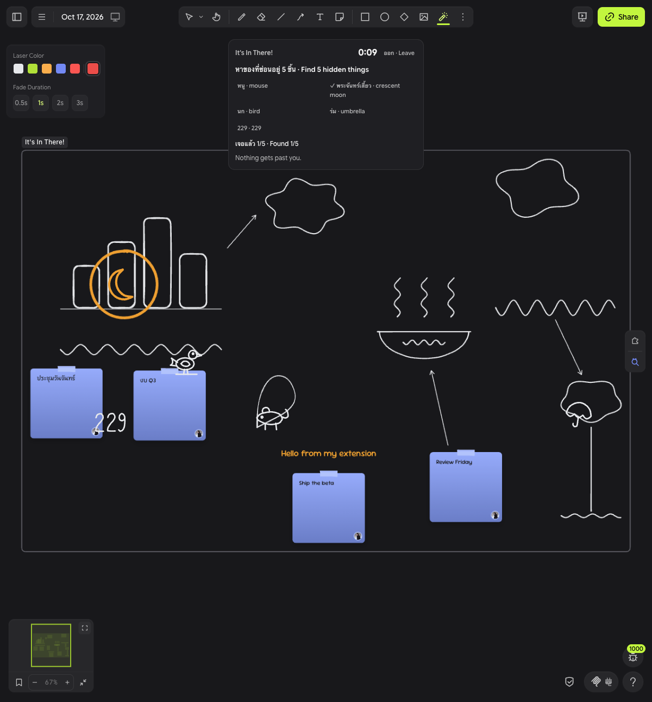

# It's In There!

A hidden-object race on your own Drawdy board. Line-art things are hidden inside what your group drew, and everyone races to circle them with the laser pointer.

หาของที่ซ่อนอยู่ในรูปที่เพื่อนวาด แล้ววงด้วยเลเซอร์ให้เร็วที่สุด · Find the things hidden in your drawings, and circle them with the laser first.



## How to play

1. **Pick the area.** Select some drawings, or scroll so they fill your view.
2. **Click the magnifier button** in the board's right-hand rail. The extension wraps the area in a frame named "It's In There!" and starts a round.
3. **Hunt.** Small line drawings, such as cats, a fish, a key, and the number 229, appear inside the frame in your board's stroke style. The banner at the top lists what to find and counts down.
4. **Circle each one with the laser.** The extension switches to the laser for you. If you switch away, press `K` to get it back. A loop around a target or a short scribble over its centre counts. A loop around the whole frame does not.
5. **Finish the round.** A find turns the finder's colour, and a small ring marks it on the board. When time runs out, the targets nobody found blink red.
6. **Play again or stop.** Click **Next round** for another round, or **Stop** to end the hunt. The frame and the found rings stay on the board.

Every round you clear raises the level, up to level 4. A round that times out stays at the same level.

| Level | Targets | Time |
| ----- | ------- | ---- |
| 1     | 3       | 60 s |
| 2     | 4       | 50 s |
| 3     | 5       | 40 s |
| 4     | 6       | 30 s |

The banner and the taunts are in Thai and English. Click the magnifier again with a hunt frame in view to rejoin that frame.

## Install

### On a local board, from source

Development links work only on local boards.

1. Run the dev server:

	```bash
	npm install
	npm run dev
	```

	The server listens on `http://localhost:5183`. `vite.config.ts` pins that port.
2. Open a local board in Drawdy.
3. Press `⌘K` (`Ctrl+K` on Windows or Linux) and run **Add extension dev server**. Enter `http://localhost:5183` and click **Connect**.

Drawdy reloads the extension each time you save a driver source file. A reload ends any hunt in progress.

### From the packaged file

```bash
npm run build
```

The build writes `dist/mingrath1-its-in-there.drawdyx`. This zip holds `manifest.json` and `main.js`, and it is the whole extension. The [Drawdy quickstart](https://ddp.drawdy.io/quickstart.md) says anyone can install this file into Drawdy. It does not give the steps.

### As a private extension on cloud boards

Cloud boards cannot use a dev server. To play on one, add this repository as a private extension. Drawdy builds it in your browser from GitHub, so the repository must be public on GitHub.

1. Push this repository to a public GitHub repository.
2. Go to [Account → Extensions](https://drawdy.io/account/extensions) on drawdy.io, open the **Submit** tab, and choose **Private**.
3. Paste the repository URL and click **Add extension**.
4. On a board, open **Extensions → Private** and install it.

If you leave the branch empty, installed copies follow new commits on the default branch. They check at most every 6 hours. Editors of a cloud board where you install it get it too. Viewers do not.

## Permissions

Drawdy asks for each permission the first time the extension needs it. Nothing is asked until you click the magnifier button. Click **Allow** on each prompt. Dismissing a prompt can save a Deny for that device.

| Permission      | Why it needs it |
| --------------- | --------------- |
| `dom`           | The banner with its countdown, its list of targets, and its buttons. |
| `scene`         | Reading the drawings in the frame, drawing the targets, and adding the hunt frame and the found rings. |
| `collaboration` | Your name and colour, for the scoreboard and for the colour of your finds. |

It never edits your drawings. The targets are preview elements on each player's screen, so they are not saved and do not sync. The only things it adds to the board are the hunt frame and one small ring per find, inside that frame.

## Multiplayer

### Without a backend

By default the extension plays offline. Each player's driver runs the whole game in-process with `LocalHost`, so each player races alone. Two players on one frame get separate rounds. An offline room lasts until the extension reloads.

### With a backend

The backend in `server/` is a Cloudflare Worker with one Durable Object per hunt frame. Everyone who joins one frame shares one room, one set of targets, and one scoreboard. The first player to circle a target gets it.

1. Deploy the backend:

	```bash
	cd server && npm install && npx wrangler deploy
	```

	Wrangler prints the Worker's `https://` URL.
2. Set `BACKEND_URL` in `src/driver/config.ts` to that URL:

	```ts
	export const BACKEND_URL: string | null = "https://its-in-there-room.<your-subdomain>.workers.dev";
	```

3. Rebuild with `npm run build`, or let the dev server reload. For a private extension, commit and push the change. Drawdy builds from GitHub.
4. Start a new hunt. Everyone on the board who clicks the magnifier button with that frame in view joins the same room.

Notes:

- The backend must be on public HTTPS. The driver runs in a worker that cannot reach `localhost`.
- A hunt frame stores the backend URL when it is created. Frames made before you set `BACKEND_URL` stay offline, so start a new frame.
- The frame holds the room's join token. Anyone who can open the board can join the room.
- A room takes 32 players online at once. Another player stays on "Connecting…" and retries until a place frees.
- A room keeps up to 256 players on its scoreboard. A new player after that is told the room is full, because a scoreboard place never frees.
- When the board syncs slowly between two tabs of the same player, both tabs can write a found marker for one find, and the extra circle stays until a later room update reaches a tab that sees both.
- The `Room` class uses SQLite storage. Cloudflare's Workers Free plan allows only SQLite-backed Durable Objects, so this backend fits it. Free-plan usage has daily limits, so check your plan against [Durable Objects pricing](https://developers.cloudflare.com/durable-objects/platform/pricing/).

## Development

Run the tests:

```bash
npm test
cd server && npm test
```

`npm test` runs the driver and shared tests with `node --test`. Node runs the `.ts` files directly, so use a Node version with type stripping on by default. The tests last passed on Node 26. `cd server && npm test` runs the backend tests with Vitest in the Workers runtime. `npm run typecheck` checks the driver.

The repository has three parts:

- `src/driver/` is the Drawdy driver. `hunt.ts` handles the button, the banner, the targets, and laser judging. `local-host.ts` is the offline room, and `remote-host.ts` talks to the backend over a WebSocket. `config.ts` holds `BACKEND_URL`.
- `src/shared/` holds the game itself. `rules.ts` is the game as a pure reducer. `placement.ts` hides the targets, `judge.ts` decides whether a laser stroke found one, and `protocol.ts` defines the messages between driver and room.
- `server/` is the Worker and the `Room` Durable Object in `server/src/room.ts`.

The rules run in both places from one copy. `LocalHost` and the `Room` Durable Object both import `src/shared/rules.ts`, so offline play and online play follow the same rules. Drawdy bundles `src/index.ts` with esbuild and allows no npm imports, so the shared code has no dependencies.

`docs/design/` holds the protocol design arena. `gpt.md`, `grok.md`, `gemini.md`, and `muse.md` are four proposals, and `JUDGE.md` compares them. The top comment in `src/shared/protocol.ts` says which parts each one contributed. `docs/FACTS.md` lists the platform facts the design relies on.

## Credits

- The backend started as a copy of [earendil-works/pi-durable-cloudflare](https://github.com/earendil-works/pi-durable-cloudflare) at commit `dcb56ce`, under the MIT License. See `server/LICENSE` and `server/NOTICE`.
- The stamps in `src/stamp-pack.ts` are placeholder line art. They should be replaced with human-drawn stamps. `docs/stamp-sheet.png` shows them all.
